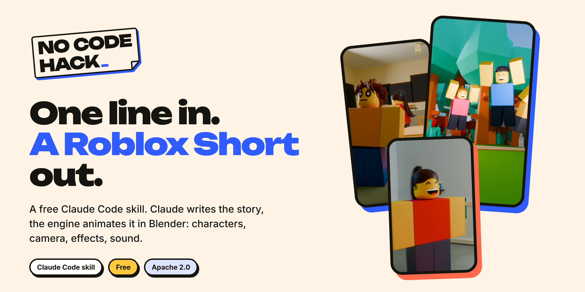
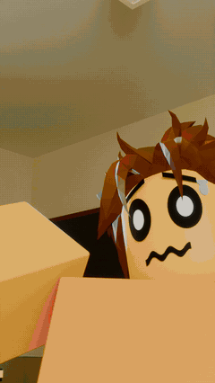
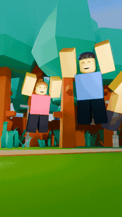
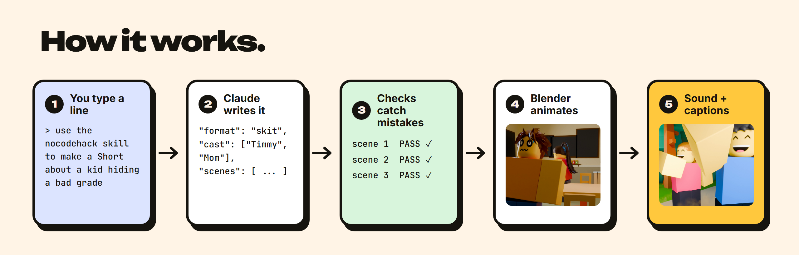
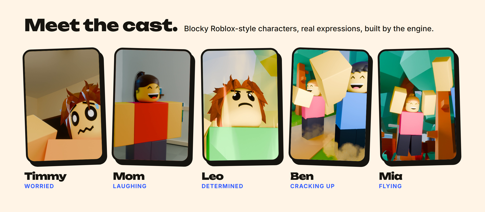
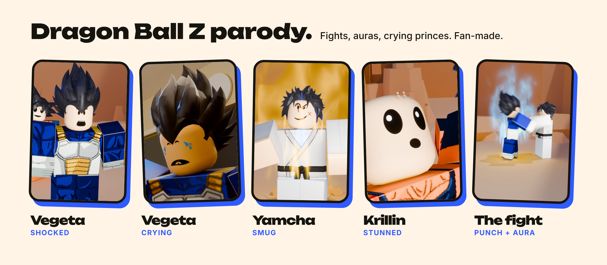
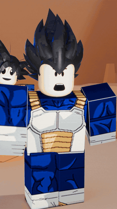
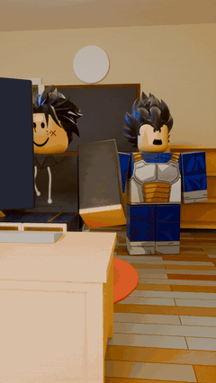

<p align="center">
  
</p>

<p align="center">
  <b>Type one sentence in Claude Code. Get a finished 9:16 animated Roblox-style Short.</b><br>
  Claude writes the story. The engine animates the characters, moves the camera, adds effects, sound and captions in Blender.
</p>

<!-- links go here after the video is out: **Watch how it works:** VIDEO  /  **Full setup guide (free):** GUIDE -->

<table align="center">
  <tr>
    <td align="center"><br><sub><b>The Flush</b> · skit · one typed line</sub></td>
    <td align="center"><br><sub><b>In this world, everyone flies</b> · narrator story</sub></td>
  </tr>
</table>

<p align="center"><sub>Both clips were made by the engine from one sentence. No hand animation.</sub></p>

---

## How it works



1. **You type one line.** `use the nocodehack skill to make a Short about a kid who tries to hide a bad grade from his mom`
2. **Claude writes the story.** One file, `stories/<name>/story.json`: who is in it, where, what each character does and says, beat by beat.
3. **Checks catch mistakes before anything renders.** Every scene is built and measured: feet on the floor, hands on the object they hold, faces in frame, nobody walking through a table. Each scene must print `REPORT PASS`, and Claude fixes whatever fails.
4. **Blender animates it.** Walks, sits, grabs, punches, Roblox emotes, expressions, camera cuts and effects. You pick the quality: a quick draft, a preview, or the version to post.
5. **Sound and captions.** Sound effects on every action, a music bed, voices or Roblox-style blips, burned-in captions, mastered to YouTube loudness.

Want a change? Say it in one sentence: *"make it again, but slower, and make the mom cry a little."* Claude edits the story and the engine rebuilds it.

## Meet the cast



Every character is a classic blocky R6 Roblox body. You describe them and Claude builds them:

- **Look:** real Roblox hair and clothes (about 50 hair styles and 110 shirts and pants, from school uniforms to Saiyan armour), plus any shirt, pants and skin colour.
- **Faces:** over 130 classic Roblox faces tagged by emotion (worried, smug, crying, shocked...), switched automatically as the story moves.
- **Acting:** talking mouths, gestures, reactions, Roblox's own emotes (wave, dance, cheer, shrug, laugh...), fights with hit effects.
- **Worlds:** bedrooms, classrooms, kitchens, shops, parks and more, with lighting moods (warm, cool, dramatic, sunset, night, spooky).

## Dragon Ball Z parody



Anime fights work out of the box: punches, kicks, uppercuts, blocks, dodges, knockbacks, auras, energy beams, hit sparks and big reactions. The repo ships the parody story as an example (`stories/parody_dbz_fight`), and here is the one-sentence change in action:

<table align="center">
  <tr>
    <td align="center"><br><sub><b>Yamcha came back</b> · the first version</sub></td>
    <td align="center"><br><sub><i>"make it again, but slower, and make Vegeta cry a little"</i></sub></td>
  </tr>
</table>

<sub>Fan-made parody for fun and education. Not affiliated with or endorsed by the owners of Dragon Ball Z. Character outfits and hair come from free Roblox catalog items, fetched by your own Roblox Studio.</sub>

## Story formats built in

No idea yet? Name a format, or let Claude pick one that fits your idea. Each format sets the length, captions, camera and voice for you.

| Format | What it looks like | Try typing |
|---|---|---|
| **Skit** | a relatable family or school moment, "X be like" | *a Short about a little brother who finds your phone* |
| **POV** | the camera is your eyes, characters talk to you | *a POV Short where you're the new kid at school* |
| **Time-stamped** | a day told in jumps: 7:00 AM, 3:00 PM, 3:00 AM | *a day in the life of a kid on the last day of school* |
| **In this world...** | a strange rule for the whole world, told by a narrator | *in this world, kids are the teachers* |
| **Story + twist** | narrated story with a freeze-frame reveal | *a kid saves his lunch money for a month, with a twist* |
| **Versus** | split screen, two ways to do the same thing | *noob vs pro at making breakfast* |
| **Choice** | "1 or 2?", the viewer picks | *would you rather be invisible or fly* |
| **Anime fight parody** | a Dragon Ball Z style fight with auras and reactions | *Vegeta and Goku fight over the last slice of pizza* |
| **Rich vs poor**, **Ranking**, **What if**, **Text story** | also supported | |

The full guide Claude follows is in [`FORMATS.md`](skills/roblox-engine/engine/FORMATS.md).

## Install

**A. As a Claude Code plugin (recommended)**
```
/plugin marketplace add nocodehack/nocodehack-roblox-engine
/plugin install nocodehack@nocodehack-roblox-engine
```

**B. Without the plugin system**
1. Click **Code > Download ZIP** on this page and unzip it.
2. Copy the folder `skills/roblox-engine` into `~/.claude/skills/` (Windows: `C:\Users\<you>\.claude\skills\`), so you get `~/.claude/skills/roblox-engine/SKILL.md`.
3. Restart Claude Code.

## Your first Short

Open Claude Code in an empty folder and type:
```
use the nocodehack skill to make a Short about a kid who tries to hide a bad grade from his mom
```

On the first run Claude:
1. copies the engine into `./nocodehack-engine/` and checks your machine (Blender, ffmpeg, Python);
2. downloads the Roblox faces and clothes from Roblox (about 5 minutes, automatic);
3. asks you to open **Roblox Studio** (any place, Edit mode) with the Studio MCP connected, then grabs the hair, animations and sets from it (about 20 minutes, once). Nothing is saved or published. Studio is what gives the engine real Roblox assets in minutes instead of building them by hand, so this step is required.

Then it writes the story, runs the checks, shows you a draft, and renders the quality you pick.

| Quality | What you get | Time for a 60 s Short |
|---|---|---|
| Draft | flat preview to check the story and camera | minutes |
| Preview | real lighting, lower resolution | ~1 h on a laptop GPU |
| Mid | the version to post | ~2 h |
| Cloud | top quality on rented GPUs (Google Cloud, you pay) | setup in the guide |

## Real voices (optional)

By default characters speak in Roblox-style blips with captions, which is free. For real voices, record your own lines or use your ElevenLabs account ([sign up here](https://try.elevenlabs.io/m7d07a0chdsb), affiliate link):
```
use the nocodehack skill to give the characters real voices with ElevenLabs. My API key is <key>, save it in a private .env file and never show it again. Use my saved voices: Kid = <voice name>, Mom = <voice name>.
```
Claude shows the character cost first, makes every line with the newest model, and times each mouth to its line. Narrator formats use the same route.

## Post it (optional)

Post straight to YouTube with [Blotato](https://blotato.com/?ref=nocodehack) (affiliate link):
```
connect Blotato to Claude Code with my API key <key>, keep the key private, and list my connected accounts
post this Short to my YouTube as private, and show me what you'll send first
```
Claude always shows you exactly what it will send and waits for your yes. Posts are private unless you say otherwise. Details: [`docs/POSTING.md`](skills/roblox-engine/engine/docs/POSTING.md).

## Requirements

- [Claude Code](https://claude.com/claude-code)
- [Blender 5.2](https://www.blender.org/download/)
- [ffmpeg](https://ffmpeg.org/download.html) (with ffprobe) on your PATH
- Python 3.10+ with `numpy` and `pillow`
- A GPU for local renders (NVIDIA, AMD or Apple; CPU works but is slow)
- [Roblox Studio](https://create.roblox.com/) (free, logged in) with the Roblox Studio MCP connected to Claude Code: the engine gets its hair, animations and sets from it

## FAQ

**Is it free?** Yes. The engine and skill are free. Claude Code runs on your own Claude plan. ElevenLabs, Blotato and cloud rendering are optional paid services.

**Who owns the Shorts?** You do, 100 %. Monetise them, no credit needed.

**Do I need to know Blender or animation?** No. You never open Blender. Claude writes the story file and the engine does the animation.

**Why do I need Roblox Studio?** The hair, clothes, faces, animations and sets belong to Roblox and their creators, so the repo ships only their ids. Your own Roblox Studio downloads the real assets on your PC on the first run, in about 20 minutes. Building them by hand would take days.

**Can I change the engine?** Yes. Ask Claude to teach it a new move, effect or camera rule. That is engine code, so it uses more of your Claude plan than making a Short.

## Licence

Apache 2.0 (see [`LICENSE`](LICENSE) and [`NOTICE`](NOTICE)). Use it, edit it, make money with it. If you republish the engine itself, keep the `NOTICE` file.
Sounds and effects included here are CC0 (see the `LICENSES.md` files under `skills/roblox-engine/engine/assets/`).

<p align="center"><sub>Made by <a href="https://www.youtube.com/@nocodehack">NoCodeHack</a></sub></p>
